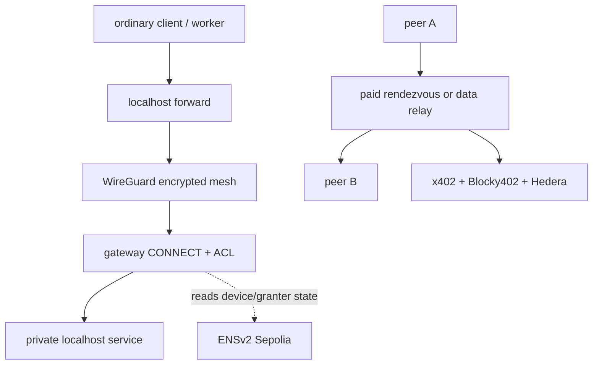

# Bramble

Bramble gives devices and automated workers private network access without making a coordination server the authority. Device identities, revocation, and scoped service grants live in an ENSv2 subname registry. Every WireGuard peer resolves that registry independently before accepting another peer. Public relay operators can be discovered through ENS and paid for rendezvous or byte allotments through x402 on Hedera.

The hackathon demo is one concrete access lifecycle: a thin health-check worker reaches an internal HTTP task API through a Bramble forward, an ungranted request is denied, a human-approved on-chain ACL expansion makes the identical request succeed without a restart, and revoking the worker removes it from the gateway's WireGuard peer table.

## Pre-existing vs new

The Mumbai continuity entry separates work that existed before the hackathon from work built during it.

- **Baseline:** commit `28e2a8f`, tagged `pre-mumbai`. Everything in this repository at that commit is pre-existing.
- **New work:** every commit after `28e2a8f`. List it with `git log pre-mumbai..HEAD`.
- **Not new work:** polish, bug fixes and documentation of pre-existing behavior.

### Pre-existing at `pre-mumbai`

The sections below this one, from "Why the integrations matter" to "Open source and AI usage", describe the pre-existing system, except where they link to a row in the next table. The pre-existing system includes `brambled/`, `sidecar/`, `relay/`, `relay-sidecar/`, `admincli/` and `dashboard/`.

### New since `pre-mumbai`

This table is the index of new work. Each agent adds or updates its row in the same pull request as the work. A status other than `planned` needs a link to the pull request or commit that backs it.

| Workstream | New work                                                                                                                                                                                                                                                                   | Status                                                                                                                                                                                                                                                                                                       |
| ---------- | -------------------------------------------------------------------------------------------------------------------------------------------------------------------------------------------------------------------------------------------------------------------------- | ------------------------------------------------------------------------------------------------------------------------------------------------------------------------------------------------------------------------------------------------------------------------------------------------------------ |
| W1         | Approval service and web UI: access requests plus device join, enrollment and revocation                                                                                                                                                                                   | in review ([PR #41](https://github.com/WhyAsh5114/bramble/pull/41)); Sepolia join smoke Open                                                                                                                                                                                                                 |
| W2         | Agent protagonist: MCP server that lets a coding agent request private access and call the private service                                                                                                                                                                 | planned                                                                                                                                                                                                                                                                                                      |
| W3         | Agent payments in the flow: spend, cap and HashScan link per agent                                                                                                                                                                                                         | planned                                                                                                                                                                                                                                                                                                      |
| W4         | Live activity feed in the approval UI                                                                                                                                                                                                                                      | planned                                                                                                                                                                                                                                                                                                      |
| W5         | Single-command launcher, reset script and public deployment; [self-contained device binaries](docs/reference/node-release.md). The on-device launcher is `bramble` in `node-daemon/` (`bramble up`, local control API and join lifecycle, `docs/reference/node-config.md`) | partial: compiled runtime ([c3d65ce](https://github.com/WhyAsh5114/bramble/commit/c3d65ce)); launcher and join lifecycle in review ([PR #38](https://github.com/WhyAsh5114/bramble/pull/38)); reset script and public deployment planned; end-to-end run against the real Sepolia ENS Open                   |
| W8         | STUN endpoint discovery, hole punching and automatic relay fallback                                                                                                                                                                                                        | planned                                                                                                                                                                                                                                                                                                      |
| W9         | Control plane over Tor: sidecar ENS reads and payment requests; [flagged ENS read batching](docs/reference/fast-resolve.md)                                                                                                                                                | partial, [PR #17](https://github.com/WhyAsh5114/bramble/pull/17): ENS and payment fetches routed, Tor-exit check Verified 6 Nov, revocation over Tor measured; resolver optimization implemented ([f0bf7c0](https://github.com/WhyAsh5114/bramble/commit/f0bf7c0)), local checks Verified, cloud timing Open |
| W10        | One new Hedera service on testnet: HCS audit trail with a salted commitment per grant, revoke and settled payment, posted by the approval service                                                                                                                          | in review ([PR #22](https://github.com/WhyAsh5114/bramble/pull/22))                                                                                                                                                                                                                                          |
| W11        | Demo infrastructure: cloud nodes, logging RPC proxy, public console, preflight                                                                                                                                                                                             | planned                                                                                                                                                                                                                                                                                                      |
| ETH-177e   | Local web UI for the curl-install flow: join, status, peers, test connection and admin view, built against a mock of the local API                                                                                                                                         | in review (screenshots in `docs/screenshots/local-ui/`)                                                                                                                                                                                                                                                      |
| ETH-177 T6 | Relay-first forwarding for a key-less device: operator-sponsored, capped relay sessions for enrolled devices (`relay -sponsor-enrolled`, `brambled -sponsored-relay`)                                                                                                      | in review: Verified in a symmetric-NAT Docker lab and with the real `relay` binary on loopback; live relays machine Open ([ADR 0018](docs/adr/0018-sponsored-relay-sessions.md))                                                                                                                             |

W6 (this documentation) is a deliverable and not a feature. W7 (Ledger approval signing) is out of scope.

## CROPS

Bramble targets the Ethereum Foundation's CROPS properties: censorship resistance, open source, privacy and security. The claim is "no trusted coordinator", not "no infrastructure": each letter below says what still depends on a third party. Labels: **Verified** (we ran it), **Read from source**, **Open** (not tested).

**C (censorship resistance).** Admission never depends on our relay. A peer is admitted only after it resolves the device's ENS record itself, so a relay cannot admit, block or revoke anyone (Read from source: `brambled/admission/loop.go`).

- If a relay disappears, tunnels that already run peer to peer keep running. Nodes that cannot reach each other directly lose that path unless another relay is in the relay registry: relay discovery is on-chain, and `brambled` buys a session from another relay when a data relay stalls (`watchDataRelayFailover`; Gate 4.3 in the [build plan](docs/05_BUILD_PLAN.md) records a live kill-and-failover run on 10 Sept 2026). New endpoint exchange needs a reachable rendezvous relay (Read from source).
- If the RPC provider disappears, ENS reads fail. The sidecar uses one RPC URL (`SEPOLIA_RPC_URL`, default a public Sepolia endpoint) and has no second provider. `brambled` keeps admitted peers for `-max-stale` (default 2 minutes) and then removes them, which drops their tunnels. The only remedy is to point `SEPOLIA_RPC_URL` at another provider and restart. Revocation, enrollment and ACL changes cannot take effect while ENS is unreachable (Read from source).
- Tor adds a dependency. The node has no clear-net fallback by design: `brambled` fails to start if the sidecar's Tor client is not ready within its wait (a sidecar that predates Tor and answers 404 on `/tor/status` is treated as ready), and the sidecar's data routes answer 503 until then ([ADR 0013](docs/adr/0013-tor-transport.md)). If the Tor network is blocked where a node runs, that node cannot read ENS (Read from source; Open: no test from a network that blocks Tor).
- Hedera testnet and the Blocky402 facilitator are required to buy relay sessions, so a node without them cannot buy a new one.

**O (open source).** Bramble is MIT-licensed ([LICENSE](LICENSE)). The Tor client, tor-js 0.4.4, is MIT OR Apache-2.0 (Read from source: its `package.json`). Anyone can build and check it: `pnpm install --frozen-lockfile`, `pnpm verify` and `pnpm test:access-flow` need Node 22, pnpm 10, Bun and Go 1.27, and no account or key. Services we do not host stay outside this claim: the public Sepolia RPC endpoint, the hackathon ENSv2 deployment, Hedera testnet and the Blocky402 facilitator. We have not checked their licences (Open).

**P (privacy).** Each row is what that party learns.

| Party                                         | What it learns                                                                                                                                                                                                                                                                                              | Label                                                                                                                          |
| --------------------------------------------- | ----------------------------------------------------------------------------------------------------------------------------------------------------------------------------------------------------------------------------------------------------------------------------------------------------------- | ------------------------------------------------------------------------------------------------------------------------------ |
| RPC provider                                  | A Tor exit address, not the node's IP address. It still sees the tailnet name, the device labels and the records read, and the polling rhythm. It cannot tie them to one machine unless the node's traffic pattern or payments give that away.                                                              | Read from source. The exit-address check ran against the Tor Project's check service, not this provider (Verified, 6 Nov 2026) |
| Payment endpoint (relay-sidecar)              | A Tor exit address, on a circuit separate from the ENS reads. It also learns the payer's Hedera account, which is public on the ledger with the amount.                                                                                                                                                     | Read from source                                                                                                               |
| Rendezvous relay                              | The node's IP address, its WireGuard key, its peer's key, the paid token and the node's public endpoint. The relay and relay-sidecar run on one machine, so the operator can link the payer's Hedera account to the node's IP address and key.                                                              | Read from source (inference from source, untested)                                                                             |
| Data relay                                    | Each participant's source IP address on the session's UDP port. The operator can associate the payer with that session.                                                                                                                                                                                     | Read from source (inference from source, untested)                                                                             |
| Data-relay price quote (`GET /price`)         | The node's IP address. `brambled` sends it directly, not through Tor.                                                                                                                                                                                                                                       | Read from source                                                                                                               |
| STUN server                                   | The address and port of whoever asks. STUN uses UDP and shares the WireGuard socket, so it cannot use Tor. Discovery stays in memory and does not publish topology to ENS. A STUN result does not prove a direct path works across a NAT. See [STUN reference](brambled/README.md#stun-endpoint-discovery). | Read from source                                                                                                               |
| Peers                                         | Each other's IP addresses, because WireGuard is UDP and Tor carries TCP only.                                                                                                                                                                                                                               | Read from source                                                                                                               |
| Tor guard relay and the node's network        | That this host uses Tor. They do not see the RPC request.                                                                                                                                                                                                                                                   | Read from source                                                                                                               |
| DNS for `-rendezvous` and `-data-relay` names | The system resolver sees the relay host names.                                                                                                                                                                                                                                                              | Open                                                                                                                           |

The sidecar sends its ENS reads and x402 payment HTTP through Tor under separate isolation keys, so they never share a circuit (Verified, 5 Nov 2026 spike; two requests left through two different exits on 6 Nov). The Hedera signer made no call on the network paths our test guards ([audit](docs/W9a_NETWORK_CALL_AUDIT.md); the guard cannot see native addons or every Bun import, so this does not prove no packet was sent). tor-js is marked experimental by its authors, and we claim only that requests leave through Tor exits.

**S (security).** Every key is held in software today.

- The node's WireGuard key (`BRAMBLE_PRIVATE_KEY`) is an ordinary software key and can be copied while the device is authorized. Revoking the device on ENS is the remedy.
- The payer's Hedera key (`HEDERA_CLIENT_PRIVATE_KEY`) is a software key. `HEDERA_MAX_PAYMENT_ATOMIC` caps each payment.
- Enrollment transactions are software-signed with `SEPOLIA_PRIVATE_KEY`. `admincli` has an opt-in Ledger signing path (`LEDGER_SIGN=1`), but Ledger signing is out of scope for this build and the demo does not use it, so the Ledger paragraphs further down describe that path and not the default.
- The access-rule (ACL) write is software-signed. Key Ring encrypts the granter's key at rest, and `admincli` decrypts it briefly on the admin's machine for each grant, without a device confirmation per grant ([ADR 0001](docs/adr/0001-ledger-ring-vs-send-split.md)).
- Administrator authority over the ENS registry remains. A compromised admin key can enroll or revoke devices.

## Why the integrations matter

- **ENSv2** is the authorization source. Permissioned registries, per-name resolvers, and Enhanced Access Control separate enrollment, rotation, revocation, ACL, and relay-registration rights.
- **Ledger** serves two distinct roles: an operator's device signs the four new-device enrollment transactions through `@ledgerhq/hw-app-eth` (since `wallet-cli send` doesn't support Sepolia), while a Key Ring encrypts the administrator's ACL-granting key at rest. The latter is decrypted briefly in the admin process per grant, without a per-grant device confirmation; the ACL write is software-signed. Full status, hardware findings, and Ledger DX feedback are documented in [ADR 0001](docs/adr/0001-ledger-ring-vs-send-split.md) and [Ledger DX feedback](docs/12_LEDGER_DX_FEEDBACK.md).
- **Hedera** settles x402 payments through Blocky402 for relay access. Rendezvous uses a fixed session fee; data relays sell explicit byte allotments at a published price.

## Architecture



The relay can affect availability but does not decide admission: a peer only configures a WireGuard public key after resolving an authorized ENS record. Device records contain public keys, authorization state, and each device's own mesh address (`mesh-ip`, written once at enroll time — see [ADR 0009](docs/adr/0009-mesh-ip-allocation.md)). Relay endpoints live in a separate relay registry.

The runtime is split into five small programs:

- `brambled/`: per-node WireGuard daemon, admission loop, gateway, local forwards, relay selection and recovery.
- `sidecar/`: loopback-only ENS and payment client used by one node.
- `relay/` and `relay-sidecar/`: rendezvous/data forwarding plus public x402 resource server.
- `admincli/`: ENSv2 enrollment, role, key, ACL, and relay-registry writes.
- `dashboard/`: read-only device and relay view. Its server exposes only explicit GET routes and cannot forward payment calls.

See [the architecture document](docs/03_ARCHITECTURE.md) and [ADRs](docs/adr/) for trust boundaries and rejected alternatives.

## Install and verify

Requirements: Node.js 22, pnpm 10, Bun, and Go 1.27.

```sh
pnpm install --frozen-lockfile
pnpm verify
pnpm test:access-flow
```

`test:access-flow` runs a rootless, deterministic integration test with real userspace WireGuard nodes and real TCP proxying. It exercises an allowed private task, denial outside scope, a live capability expansion, the identical newly-allowed task, and device revocation. Its resolver is in-memory; live ENS transactions and two-machine behavior are separately recorded in the [node runbook](brambled/README.md).

The dashboard is part of the root pnpm workspace and Turbo graph:

```sh
pnpm dev:dashboard
pnpm --filter @bramble/dashboard verify
```

## Configuration

Copy secrets into an ignored `.env` file or the process environment. Never commit values.

| Variable                              | Used by              | Purpose                                                             |
| ------------------------------------- | -------------------- | ------------------------------------------------------------------- |
| `BRAMBLE_TAILNET_NAME`                | node/admin tools     | Full ENS tailnet name                                               |
| `BRAMBLE_TAILNET_REGISTRY`            | node/admin tools     | ENSv2 device registry address                                       |
| `BRAMBLE_RELAY_REGISTRY`              | node/dashboard       | Separate relay registry address                                     |
| `BRAMBLE_RELAY_REGISTRY_DEPLOY_BLOCK` | node/dashboard       | First block to scan for relay labels                                |
| `BRAMBLE_PRIVATE_KEY`                 | node                 | This node's WireGuard private key                                   |
| `SEPOLIA_RPC_URL`                     | ENS clients          | Optional Sepolia RPC override                                       |
| `SEPOLIA_PRIVATE_KEY`                 | admin tools          | Software signer for commands that have not yet been moved to Ledger |
| `HEDERA_CLIENT_ACCOUNT_ID`            | node payment sidecar | Testnet payer account                                               |
| `HEDERA_CLIENT_PRIVATE_KEY`           | node payment sidecar | Testnet payer key                                                   |
| `HEDERA_MAX_PAYMENT_ATOMIC`           | node payment sidecar | Per-payment ceiling; defaults to 100,000 atomic USDC (0.10 USDC)    |

`brambled serve` also applies `-max-relay-price-per-byte` and `-max-relay-session-cost` before purchasing a data-relay session. See [brambled's command reference](brambled/README.md) and the package READMEs for the full launch flags.

## Demo path

1. Start a private backend on the gateway, for example `(cd brambled && go run ./cmd/demo-service -port 9100)`.
2. Start registered gateway and worker nodes using the two-machine commands in the [client-forwarding runbook](brambled/README.md#client-forwarding-runbook--an-unmodified-client-through-a-real-gateway). Give the gateway `-service web=9100`; give the worker `-forward 8080=gateway-label:web`.
3. Run `(cd brambled && go run ./cmd/demo-agent -url http://127.0.0.1:8080/task)`. The worker has no backend credential, and the request fails while it lacks the matching ACL digest.
4. Trust the granter on the gateway with `pnpm --dir admincli set-acl-granters -- <gateway-label> <granter-label>`, then grant the service with `pnpm --dir admincli set-acl -- <worker-label> <gateway-label> <granter-label> web`. The identical agent command prints a private-service health result without restarting either node.
5. Revoke the worker with `pnpm --dir admincli revoke -- <worker-label> true`. The gateway removes it on its next ENS poll and the task fails at the tunnel boundary.

For the recorded demo, distinguish the two Ledger paths: enrollment transactions are hardware-signed, while `set-acl` decrypts the granter secret through Key Ring on the provisioned admin machine and submits a software-signed ENS write. Do not describe the ACL write as requiring a per-grant device confirmation.

The paid relay proof is run separately with `brambled demo-data-relay`; it prints the Hedera settlement transaction IDs for differently sized sessions and for pre/post-failure relay selection. See [relay-sidecar's runbook](relay-sidecar/README.md).

## Payment flow

1. A node discovers relay labels and public payment URLs from the ENS relay registry.
2. It requests a rendezvous token or data-relay byte allotment from a relay-sidecar.
3. The relay-sidecar responds with x402 payment requirements.
4. The node sidecar signs a Hedera testnet USDC payment, subject to its configured atomic cap, and retries the request.
5. Blocky402 verifies and settles the payment. The resource server returns a one-use rendezvous token or ephemeral UDP relay session and Bramble prints the settlement ID.

## Evidence and limitations

The [build plan](docs/05_BUILD_PLAN.md) links the adversarial tests, live Sepolia transactions, two-machine runs, physical Ledger findings, and Hedera settlement IDs. The measured already-connected revocation time was 3.7 seconds with a five-second poll interval and a responsive resolver. Over Tor, the sidecar's ENS poll took a median of 7.0 to 11.5 seconds across two 10-minute runs on 6 November 2026, against 3.9 to 4.4 seconds without Tor on the same machine, with a worst case of 29 seconds. The Tor figures come from replaying a timed trace on one machine, not from a live revocation. See the [measurement note](docs/measurements/2026-11-06-revocation-over-tor.md).

This is a hackathon prototype. STUN endpoint discovery is available through `-stun-servers` or `BRAMBLE_STUN_SERVERS`; `GET /endpoint` on the node status API reports the observation. Automatic hole-punch failure detection is not implemented; relay use is selected explicitly for the demo topology. Mesh IPs are auto-assigned at enroll time and peer discovery is full-mesh-by-default when no `-peer` flags are given (`docs/adr/0009-mesh-ip-allocation.md`, `docs/adr/0010-full-mesh-peer-discovery.md`) — network-layer admission only, ACL still gates service access independently. The default public Sepolia RPC endpoint is a load-balanced pool with observed multi-thousand-block sync lag between backends; **export** `SEPOLIA_RPC_URL` to a dedicated endpoint before launching admin commands and nodes for a live demo. Relay sessions use first-two-source UDP learning, do not handle NAT remapping, and expire after five minutes. A node key is an ordinary software key and can be copied while authorized. The payer is likewise a software key. ENS/RPC availability, administrator authority, host security, and relay availability remain dependencies.

## Open source and AI usage

Licensed under the MIT License. Third-party libraries and starter code retain their own licenses. AI assistance and the human-directed design trail are disclosed in [AI usage](docs/AI_USAGE.md).
